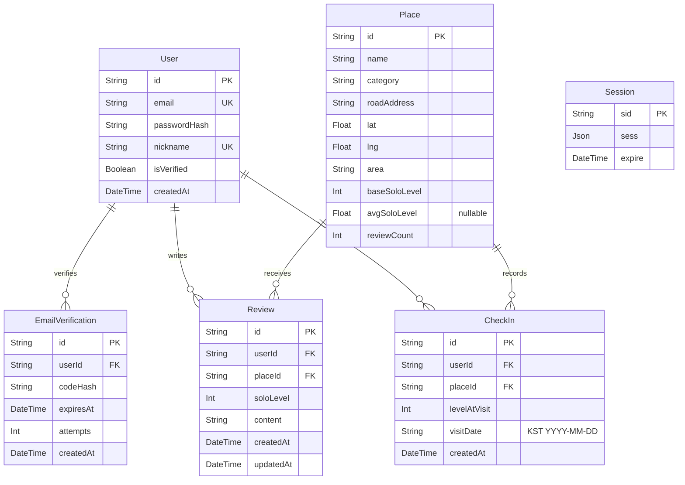

# SoloMap | 명지대학교 혼밥지도

혼자 식사할 곳을 찾는 명지대 학우를 위한 식당 탐색 웹 서비스입니다. 일반적인 맛집 평점에 더해 5단계 혼밥 난이도와 식당별 안내를 제공하고, 지도·목록·랜덤 추천으로 선택을 돕습니다.

[서비스 보기](https://mju-solomap.vercel.app/) ·
[기술 의사결정과 트러블슈팅](TROUBLESHOOTING.md)


## 문제와 구현

혼자 방문하기 편한 식당을 빠르게 찾도록 식당 탐색 기준과 화면을 설계했습니다. 개인 프로젝트로 기획과 개발을 진행했습니다.

- 지도와 식당 목록, 권역별 탐색, 오늘 뭐 먹지 랜덤 추천
- 카카오 로컬 API 검색 결과와 자체 식당 데이터를 함께 사용하는 검색
- 네이버 지도 연동과 지도 표시 문제에 대한 대응
- Gemini 기반 식당 안내 생성, 파일 캐시, API를 사용할 수 없을 때의 규칙 기반 대체 안내

리뷰가 있으면 학우 리뷰 평균을 반올림해 난이도로 표시하고, 없으면 기본 난이도를 사용합니다. AI 안내와 난이도는 식당 선택을 돕는 참고 정보입니다.

## 설계와 배운 점

Express API가 외부 검색과 식당 큐레이션을 처리하고, 정적 웹 화면에 결과를 전달합니다. 이미 생성한 큐레이션은 캐시에 저장해 재사용합니다. 외부 API 실패 시에도 기본 탐색이 이어지도록 대체 흐름을 마련했습니다.

지도 API 연동, 데이터 매칭, 배포 환경 차이를 해결한 과정은 [TROUBLESHOOTING.md](TROUBLESHOOTING.md)에 정리했습니다.

## 기술 스택

| 영역      | 사용 기술                                                       |
| --------- | --------------------------------------------------------------- |
| 서버      | Node.js, Express 5, TypeScript                                  |
| 웹 화면   | HTML, CSS, JavaScript                                           |
| 외부 연동 | Kakao Local API, Naver Maps, Google Gemini                      |
| 인증      | Passport Local, express-session, bcrypt, Nodemailer             |
| 데이터    | Prisma 7.10.1, Supabase PostgreSQL, 식당 JSON, 큐레이션 캐시         |
| 배포 구성 | Vercel (`api/index.ts`, `vercel.json`), 기존 공개 링크는 Render |

## 현재 범위와 후속 작업

1~5단계 코드가 구현되어 있습니다. 학교 이메일 가입·인증, 세션 로그인·로그아웃, 공유 리뷰 CRUD, 방문 체크인, 개인 레벨·추천, 성장 기록과 정복 지도를 연결했습니다. 리뷰는 서버 API를 사용하고 찜은 브라우저 localStorage에 남깁니다.

**2026-11-09:** SoloMap 전용 Supabase를 연결하고 실제 가입·인증·리뷰 CRUD·체크인·프로세스 재시작 후 세션/기록 유지를 검증했습니다. 학교 인증 통합 테스트는 로컬 개발 코드로 수행했습니다. 이후 로컬 Gmail SMTP 설정 및 TLS/계정 인증 확인도 완료했으며 실제 학교 메일 수신 확인은 남아 있습니다. [DB 연결 기록](docs/SUPABASE_CONNECTION.md) · [검증 결과](docs/VERIFICATION.md). 2026-11-09에 디자인 수정과 DB·SMTP 설정을 Vercel 운영 환경에 배포했습니다. `PLAN.md`는 초기 아이디어 문서이며, 현재 규칙은 이 README와 실제 서비스 코드가 기준입니다.

## 실행

```bash
npm install
```

`.env.example`을 `.env`로 복사하고 필요한 값을 설정합니다. 환경변수 목록은 아래 표를 사용합니다. 실제 비밀번호·접속 URL·메일 코드·세션 쿠키는 커밋하지 않습니다.

Gemini 키 없이도 캐시 또는 규칙 기반 안내를 사용합니다. 지도 API는 사용 도메인 등록이 필요할 수 있습니다. 실제 키는 저장소에 올리지 않습니다.

```bash
npm run dev
npm run typecheck
npm run build
npm start
```

개발 주소는 `http://localhost:3000`이며, 서버 상태는 `GET /api/health`에서 확인합니다. 식당 검색은 `GET /api/places/search`입니다.

DB를 처음 연결할 때는 비어 있는 개발용 DB에서 다음을 실행합니다. 이미 데이터가 있는 DB는 현재 테이블과 마이그레이션 이력을 먼저 확인합니다. `reset`이나 데이터 손실 허용 옵션은 사용하지 않습니다.

```bash
npx prisma generate
npx prisma migrate deploy
npm run db:seed
```

`prisma/migrations/20261106000000_init/migration.sql`의 초기 테이블·인덱스·FK·RLS 설정은 SoloMap 전용 DB에 적용했습니다. 기존 테이블이 있는 다른 DB에는 위 초기 적용을 반복하지 말고 이력을 먼저 확인합니다. 시드는 식당 ID로 upsert하므로 재실행할 수 있습니다.

초기 마이그레이션은 public의 6개 테이블에 RLS를 켜며 브라우저용 Data API 정책은 만들지 않습니다. 로그인·권한은 Supabase Auth가 아닌 Express/Passport에서 검사합니다. 서버 Prisma·세션 연결은 테이블 소유자 또는 BYPASSRLS 역할을 사용해야 합니다. 일반 anon/authenticated 역할로 직접 DB 데이터를 읽는 구조가 아닙니다.

## 데이터 관계 (ERD)



- 리뷰는 `(userId, placeId)`, 체크인은 `(userId, placeId, visitDate)` 조합이 유일합니다. FK 관계는 모두 `onDelete: Cascade`입니다.
- `Session`은 connect-pg-simple 형식이며 User FK는 없습니다. Passport가 `sess` 안에 사용자 ID를 저장하고 매 요청에 사용자 정보를 복원합니다.
- 리뷰 변경과 식당 평균·개수 갱신은 하나의 Prisma 트랜잭션으로 처리합니다. 표시 난이도 계산은 `review.service.ts`에 둡니다.
- 체크인 당시 난이도가 경험치입니다. 누적 5/15/30점에서 Lv.2/3/4, 50점 이상이면서 Lv.5 식당 방문 이력이 있어야 Lv.5입니다. 개인 레벨 규칙은 `level.service.ts`가 관리합니다.

## API 목록

오류 응답은 `{ message }` JSON이며, 중복 리뷰의 409에는 편집용 `reviewId`도 포함합니다. 생성은 201, 삭제·로그아웃은 본문 없는 204입니다. 메일 발송 실패는 503이며, 실패한 가입의 새 계정/코드 또는 재발송의 새 코드만 정리해 재시도할 수 있게 합니다.

| 메서드 | 경로                                  | 권한                  | 동작 / 성공 상태                                           |
| ------ | ------------------------------------- | --------------------- | ---------------------------------------------------------- |
| GET    | `/api/health`                         | 공개                  | 서버 상태 텍스트 / 200                                     |
| GET    | `/api/config`                         | 공개                  | 네이버 공개 Client ID·계정 설정 여부 boolean / 200         |
| POST   | `/api/auth/signup`                    | 공개                  | 학교 이메일·비밀번호·닉네임 가입, 코드 발송 / 201          |
| POST   | `/api/auth/login`                     | 공개                  | Passport 로그인, 세션 쿠키 / 200                           |
| POST   | `/api/auth/logout`                    | 세션 정리             | 세션 파기·쿠키 삭제 / 204                                  |
| GET    | `/api/auth/me`                        | 로그인                | 내 정보·인증 여부·레벨 / 200                               |
| POST   | `/api/auth/verify/send`               | 로그인·미인증         | 코드 재발송 (60초 제한) / 200                              |
| POST   | `/api/auth/verify`                    | 로그인                | 6자리 코드 확인 (10분, 오입력 최대 5회) / 200              |
| GET    | `/api/places/search?query=피자`       | 공개                  | 자체 식당+카카오 검색+큐레이션+DB 집계 / 200               |
| GET    | `/api/places?area=명지대&soloLevel=2` | 공개                  | DB 식당 목록 (최대 100곳), query 검색도 지원 / 200         |
| GET    | `/api/places/:id`                     | 공개                  | 식당 상세, displaySolo, 최신 리뷰 최대 10개 / 200          |
| GET    | `/api/places/:id/reviews`             | 공개                  | 해당 식당 전체 리뷰 최신순·닉네임·인증 배지 / 200          |
| POST   | `/api/places/:id/checkins`            | 로그인·학교 인증      | KST 당일 방문 기록, 경험치·레벨 / 201                      |
| POST   | `/api/reviews`                        | 로그인·학교 인증      | placeId, soloLevel(1~5), content(1~500자) / 201            |
| PATCH  | `/api/reviews/:id`                    | 로그인·학교 인증·본인 | soloLevel 또는 content 수정 / 200                          |
| DELETE | `/api/reviews/:id`                    | 로그인·학교 인증·본인 | 리뷰 삭제·평균 재계산 / 204                                |
| GET    | `/api/users/me`                       | 로그인                | 내 정보 (`auth/me`와 동일) / 200                           |
| GET    | `/api/users/me/reviews`               | 로그인                | 내 리뷰 / 200                                              |
| GET    | `/api/users/me/level`                 | 로그인                | levelInfo / 200                                            |
| GET    | `/api/users/me/checkins`              | 로그인                | 정복 식당별 방문 횟수·최근 날짜·좌표 / 200                 |
| GET    | `/api/users/me/recommendations`       | 로그인                | 미방문 식당 중 내 레벨 또는 +1, 학교 거리순 최대 3곳 / 200 |

기존 호환 경로 `/api/reviews/me`, `/api/reviews/place/:placeId`도 유지합니다. 서버는 `/auth`, `/places`, `/reviews`, `/users` 접두사도 지원하지만 화면과 테스트는 `/api/*`로 통일합니다. 가입 API는 로그인 세션을 만들지 않으므로 화면에서 가입 후 로그인 API를 호출하고 인증 화면으로 이동합니다.

## 검증

```bash
npm run typecheck
npm run build
npx tsx scripts/verify_api.ts
node scripts/test_account_ui.cjs
npx tsx scripts/test_production.ts
```

`verify_api.ts`는 실제 Express 앱을 임시 포트에 띄워 DB 쓰기 없이 16개 요청을 확인합니다. 화면 테스트는 Chrome과 기존 puppeteer-core를 사용하며 외부 API/지도 SDK 경계는 테스트 응답으로 대체합니다. Chrome 경로는 스크립트의 `executablePath`를 설치 위치에 맞춥니다. `test_production.ts`는 로컬 SMTP 서버로 성공/거절·코드 로그·설정 누락·실패 복구를 확인합니다. 실제 DB·외부 메일 전달 검증은 별도로 필요합니다.

DB 통합 확인은 [requests.http](requests.http)의 A→R→C→B→Z 순서로 진행합니다. A와 B는 각각 소유한 학교 테스트 계정이며, 로그인 전후 쿠키 상태와 코드 재발송 대기 시간을 지켜야 401·403·409·429가 구분됩니다. [실행 결과 표](docs/VERIFICATION.md)에 실제 통과와 미실행 항목을 나눠 기록했습니다.

## 환경변수

| 이름                     | 용도                                        | 로컬 / Vercel                                           |
| ------------------------ | ------------------------------------------- | ------------------------------------------------------- |
| `PORT`                   | 로컬 HTTP 포트                              | 기본 3000 / Functions는 직접 listen하지 않음            |
| `NODE_ENV`, `VERCEL_ENV` | 운영 설정 검사·쿠키 secure 조건             | production 또는 Vercel preview/production이면 운영 처리 |
| `DATABASE_URL`           | Prisma 및 connect-pg-simple PostgreSQL 연결 | 인증·저장에 필수                                        |
| `DIRECT_URL`             | Prisma 스키마/마이그레이션 연결             | DB 설정·마이그레이션에 필수                             |
| `SESSION_SECRET`         | 세션 쿠키 서명                              | 배포에 필수, 개발 기본값이 아닌 32자 이상 임의 값       |
| `SMTP_HOST`, `SMTP_PORT` | 메일 서버·포트                              | 실제 메일 발송에 필수                                   |
| `SMTP_USER`, `SMTP_PASS` | 메일 인증 정보                              | 실제 메일 발송에 필수                                   |
| `MAIL_FROM`              | 발신자 주소                                 | SMTP에서 허용한 발신자                                  |
| `KAKAO_REST_API_KEY`     | 실시간 식당 검색                            | 없으면 자체 데이터 중심 폴백                            |
| `GEMINI_API_KEY`         | 미캐시 식당 AI 안내                         | 없으면 캐시·규칙 기반 안내                              |
| `NAVER_CLIENT_ID`        | 네이버 지도 공개 식별자                     | 사용 도메인 등록 필요                                   |

이 프로젝트는 강의와 같은 **Prisma 7.10 계열(7.10.1)**을 사용합니다. `prisma.config.ts`가 CLI 연결·마이그레이션·시드를 관리하고, `schema.prisma`의 `prisma-client`가 `src/generated/prisma`에 Client를 생성합니다. 서버는 `PrismaPg` 어댑터로 연결합니다. Vercel용 실행 연결은 `DATABASE_URL`의 트랜잭션 풀러 6543, CLI 연결은 `DIRECT_URL`의 세션 풀러 5432를 유지합니다. 기존 Prisma 6 URL 옵션은 `src/lib/database.ts`가 pg 형식으로 변환하며 CA·호스트 검증은 유지합니다.

## Vercel 배포 체크리스트

아래 항목은 배포 전 확인 목록이며, 이번 문서 작업에서 배포는 수행하지 않았습니다.

운영과 Vercel Preview에서는 DB·세션·SMTP 필수 값이 없으면 `src/lib/env.ts`가 시작을 거부합니다. 개발용 메모리 세션·콘솔 인증 코드는 로컬에서만 허용됩니다. 별도 SoloMap 프로젝트 연결 순서는 [설정 안내](docs/SETUP.md)를 사용합니다.

- [ ] Root Directory를 `package.json`, `public`, `api`, `src`가 함께 있는 앱 폴더로 설정한다.
- [ ] 위 환경변수를 필요한 Preview/Production 환경에 설정한다. 특히 `NODE_ENV=production`, 실제 `DATABASE_URL`, `SESSION_SECRET`, SMTP 설정을 확인한다.
- [ ] 설치 로그에서 `postinstall: prisma generate` 성공을 확인하고 `npm run build`를 실행한다. 배포 캐시 때문에 오래된 Prisma Client가 남지 않았는지 확인한다.
- [ ] 준비된 초기 마이그레이션을 검토·버전 관리한다. 별도의 새 SoloMap DB에 `npx prisma migrate deploy`를 실행한 뒤 시드를 적용한다. `Session` 테이블은 `createTableIfMissing:false`이므로 사전에 존재해야 한다.
- [ ] `api/index.ts` 진입점, `/api/*` rewrite, `src/data/**` 포함 설정을 Preview에서 검증한다. `/public` 파일은 CDN 정적 자산으로 제공되는지 `/`, `/main.js`, `/account.js`, `/style.css`를 직접 확인한다. [Vercel Express 안내](https://vercel.com/docs/frameworks/backend/express)
- [ ] HTTPS 로그인 응답의 `connect.sid`에 HttpOnly·SameSite=Lax·Secure·7일 유효 기간이 적용되는지 확인한다. `trust proxy=1` 설정은 이미 코드에 있다.
- [ ] 로그인 후 다른 요청/함수 인스턴스에서도 DB Session이 유지되고, 로그아웃 후 같은 쿠키로 `/api/auth/me`가 401인지 확인한다. 메모리 세션 폴백으로 배포하지 않는다.
- [x] 운영 코드 로그 제거·SMTP 실패 503·가입/재발송 실패 정리를 구현하고 로컬 SMTP 서버로 검증했다. 운영/Preview 필수 설정 누락 시 시작을 거부한다.
- [ ] 실제 SMTP 제공자에서 학교 메일로 전달되는지 확인한다. 로컬 SMTP 테스트를 실제 메일 전달 검증으로 표시하지 않는다.
- [ ] DB 미연결 시 상세·리뷰 빈 배열 폴백만 보고 DB 정상으로 판단하지 않는다. 실제 계정으로 리뷰 CRUD·체크인·세션 지속성을 확인한다.
- [ ] 네이버 등록 도메인과 Preview/Production 주소를 맞추고, 지도 인증·카카오 병합·AI 캐시·룰렛·정렬·필터·도보 시간을 확인한다.
- [ ] Functions 파일 시스템의 큐레이션 캐시 쓰기가 영속적이라고 가정하지 않는다. 번들된 캐시/규칙 폴백을 확인한다. DB 테이블의 Data API 노출·권한은 별도로 검토하고 브라우저에 DB 접속값을 전달하지 않는다.

## 주요 코드

디자인 시스템은 [컴포넌트 미리보기](public/design-system.html), [사용 규칙](design-system/solomap/MASTER.md), [UI/UX 검수 기록](docs/DESIGN_SYSTEM_AUDIT.md)에서 확인합니다. 서버 실행 후 `/design-system.html`을 열면 실제 서비스와 같은 토큰·컴포넌트를 볼 수 있습니다. 기존 오렌지 포인트, 자체 호스팅 Pretendard, 4px 간격, PC/태블릿/모바일 카드 그리드와 키보드 포커스를 공통 관리합니다.

- `src/app.ts`: 정적 화면 및 API 라우터 등록
- `src/controllers/place.controller.ts`: 식당 검색과 데이터 통합
- `src/lib/kakao.ts`: 카카오 로컬 API 연결
- `src/lib/gemini.ts`: 큐레이션 생성, 캐시와 대체 안내
- `public/`: 지도와 식당 탐색 화면
- `public/design-system.css`, `public/ui.js`: 토큰·공통 컴포넌트·SVG·모달 접근성
- `public/style.css`, `public/map.css`: 앱 레이아웃과 지도 엔진 어댑터
- `public/account.js`: 계정·서버 리뷰·성장 기록·개인 지도 연동
- `src/services/`: 인증·리뷰 집계·레벨 규칙
- `prisma/schema.prisma`, `prisma/seed.ts`: 모델과 식당 시드
